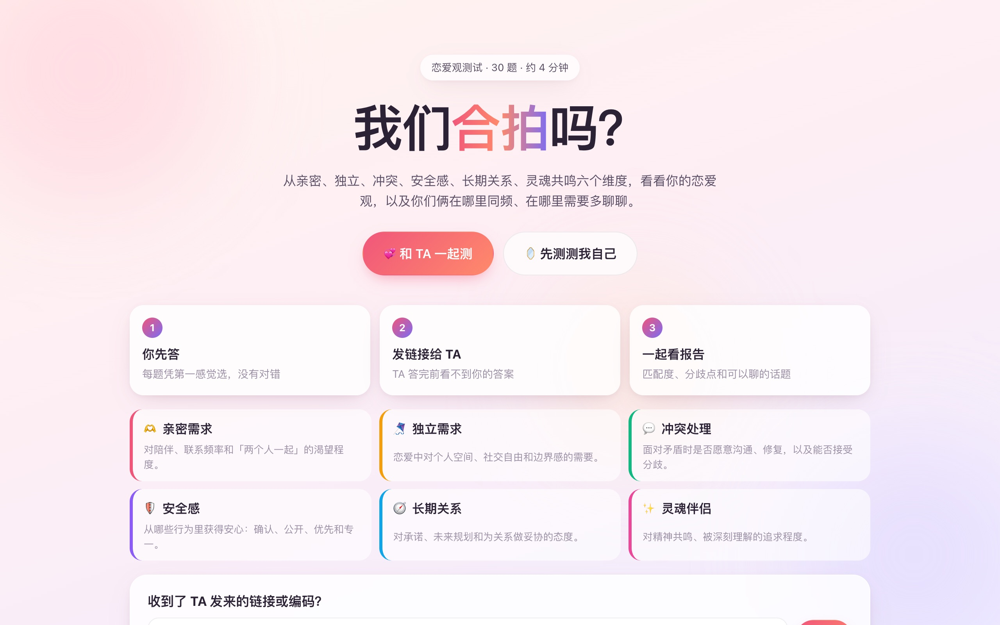
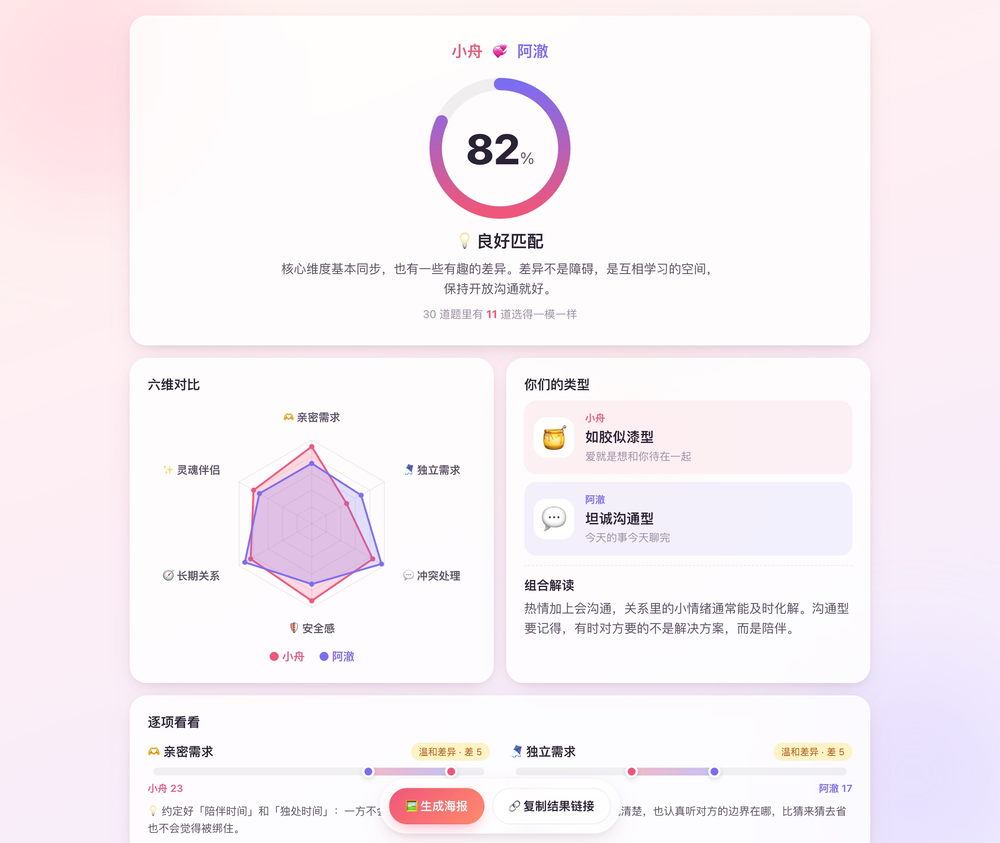
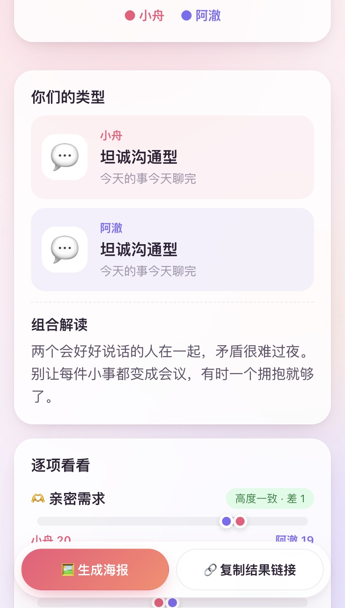
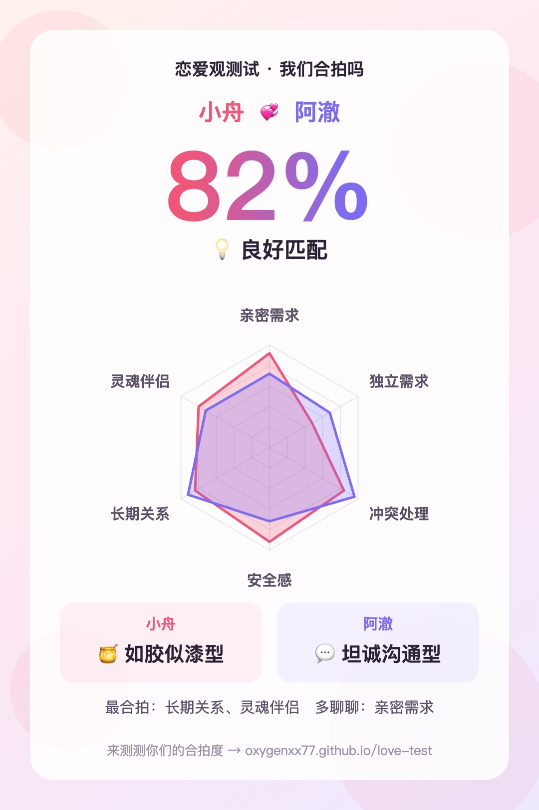
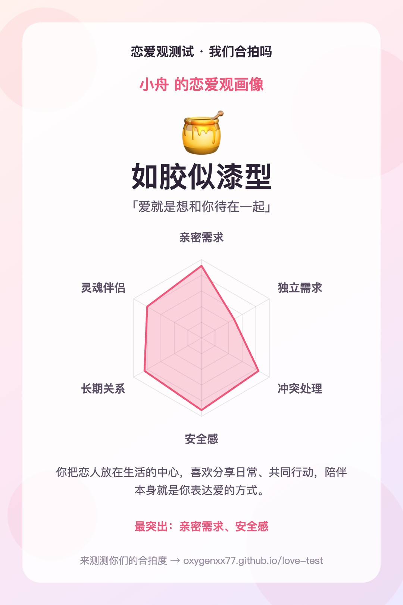
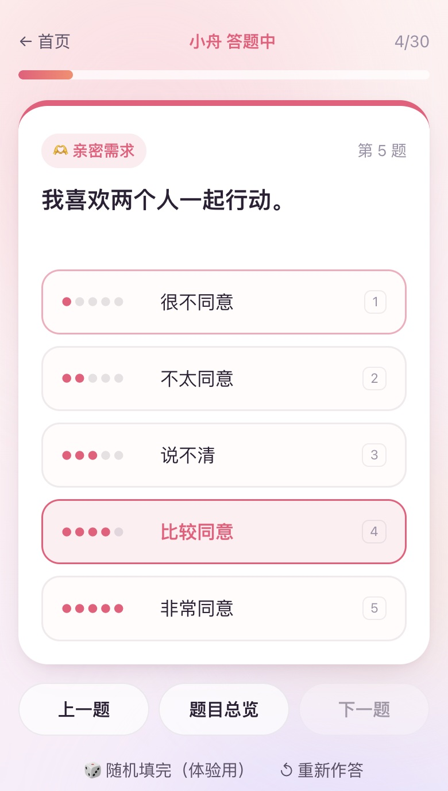

# 恋爱观测试 · 我们合拍吗？

30 道题、六个维度，测测你的恋爱观，以及你们俩在哪里同频、在哪里需要多聊聊。

**在线体验：[oxygenxx77.github.io/love-test](https://oxygenxx77.github.io/love-test/)**（手机打开体验最好）



## 怎么玩

- **和 TA 一起测（各自用手机）**：你先答完，把邀请链接发给 TA。TA 答完之前看不到你的答案；答完后双方都能看到合盘报告，TA 那边会多出一个「把结果发回给你」的按钮。
- **同一台设备轮流答**：你答完把手机递给 TA，TA 答完直接出报告。
- **先测测我自己**：只看个人恋爱观画像。之后不用重答，可以直接用这份答案邀请 TA。

## 报告里有什么

| 合盘报告 | 手机端 |
| --- | --- |
|  |  |

- 匹配度（维度接近程度 60% + 逐题接近程度 40%）和等级解读
- 六维雷达图，两个人的形状叠在一起对比
- 七种恋爱人格（如胶似漆型、自由风筝型、坦诚沟通型、安全守护型、长期建设型、灵魂共鸣型、平衡发展型），以及两人组合的解读
- 每个维度的差值和建议；**想法差得最远的 3 道题**，适合当面问问「你为什么这么选」
- 根据你们差异最大的维度，给出「今晚可以聊聊」的话题卡和 3 条建议
- 一键生成分享海报（在浏览器里用 Canvas 画，手机长按即可保存）

| 合盘海报 | 个人海报 | 答题页 |
| --- | --- | --- |
|  |  |  |

## 其他细节

- 一题一张卡片，点选后自动进入下一题；支持键盘 1–5 和左右方向键；可以打开「题目总览」跳到任意一题
- 答题进度自动保存，关掉页面回来还能继续
- 历史记录：同一组答案只记一次，可以重新打开、删除、导出 / 导入 JSON（换设备时用）
- 首页可以粘贴 TA 发来的链接或编码，也兼容旧版（Streamlit 版）导出的编码
- 高契合度会飘出爱心；系统开启「减少动态效果」时自动关闭动画

## 隐私

没有服务器，也没有统计代码。答案只存在你自己浏览器的 localStorage 里；分享时答案编码在链接里，只有拿到链接的人能看到。

## 实现

纯 HTML / CSS / JavaScript，无框架、无第三方库、无构建步骤，直接双击 `index.html` 也能用。

```
index.html
css/style.css     界面样式（移动端优先）
js/data.js        题库、维度说明、人格类型、组合解读等文案
js/engine.js      计分、类型判定、合盘分析、分享链接编解码、本地存储
js/charts.js      SVG 雷达图、Canvas 分享海报
js/app.js         基于 location.hash 的路由和各个页面
```

本地预览：

```bash
python3 -m http.server 8000
# 打开 http://localhost:8000
```

## 版本

最早的版本是 Streamlit 写的（见标签 [`streamlit-v1`](https://github.com/oxygenxx77/love-test/tree/streamlit-v1)），有几个问题一直没修好：

- 「重置」「随机填答」「导入伴侣答案」点了没反应：滑块绑定了 key，之后再改 `session_state` 不会反映到界面上
- 进度条永远显示 100%：默认值是 3，从来不会是「未作答」
- 报告生成后，页面每次刷新都会再写一条重复的历史记录；改了昵称，历史表格里的人格那两列就对不上
- 导出图片依赖服务器上的 Chrome（kaleido），部署时经常失败
- 两个人只能在同一个页面上答，互相看得到对方的答案

这一版改成纯前端重写，上面这些问题都随之消失，同时补上了邀请链接、合盘海报、逐题分歧、话题卡等功能。

## 声明

结果按题目规则计算，仅供娱乐和沟通参考。真实的关系，还要靠两个人用心经营。
